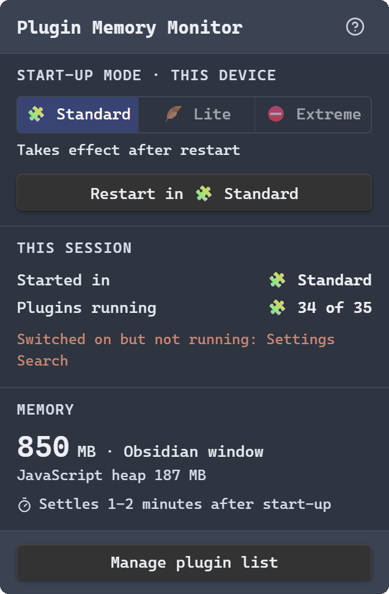
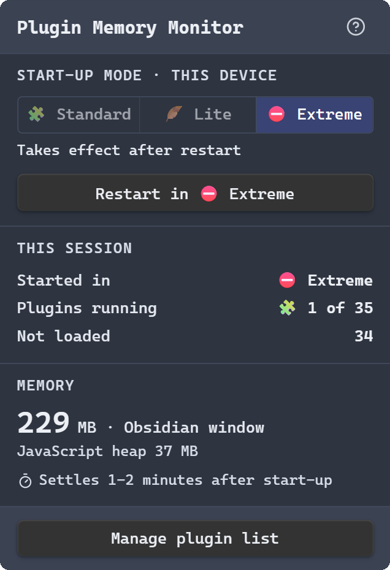

# Memory Saver

<a href="https://ko-fi.com/mohsu"></a>

**Save memory in Obsidian on resource-constrained machines.** Older laptops, low-RAM PCs and shared or virtual desktops feel the cost of every Obsidian plugin. Memory Saver lets each device start Obsidian with only the plugins it needs, so the rest never load and never use memory. It also shows Obsidian's memory and plugin count in the status bar, so you can see the effect.

| 🧩 Standard start | ⛔ Extreme start |
|:---:|:---:|
|  |  |
| 34 of 35 plugins running · **863 MB** | 1 of 35 plugins running · **229 MB** |

*The status bar popup on the same machine and vault, each read after memory had settled. Click the status bar to open it.*

| Start mode | What loads at start-up | Memory |
|---|---|---|
| 🧩 Standard | Every plugin switched on in Settings → Community plugins. Normal Obsidian. | Most |
| 🪶 Lite | Only the plugins you tick for Lite (shared across your devices), and only if they are switched on. | Less |
| ⛔ Extreme | No community plugins except this one. | Least |

Each device keeps its own start mode: a low-RAM laptop can start in Lite every day while your main PC, syncing the same vault, starts in Standard.

## Why start-up matters

Obsidian runs on Electron (Chromium). A community plugin uses memory as soon as it loads, and once loaded it keeps most of that memory until Obsidian restarts: switching a plugin off during a session hands very little back to the system. The only reliable way to save that memory is not to load the plugin in the first place, which is what the start modes do.

## How much can it save?

It depends on which plugins you use. Measured in one vault with about 35 community plugins, Obsidian 1.14.4 on Windows:

| | Window memory | JavaScript heap |
|---|---|---|
| Standard start | 446 MB | 177 MB |
| Lite start (8 plugins) | **295 MB (about a third less)** | **90 MB (about half)** |
| Switching from Standard to Extreme during a session, for comparison | 1009 MB → 976 MB | |

In the same vault, Obsidian settled at about 370 MB with no community plugins at all (Restricted mode), against roughly 590 to 950 MB with all of them, so the plugins accounted for roughly 220 to 580 MB.

## Tips for saving the most memory

- Start in **Lite** day to day, and tick only the plugins you rely on every day.
- Leave the heaviest plugins out of Lite. Plugins that index your whole vault or run AI models in the background tend to use the most memory.
- Need a plugin briefly? Use **Load now** in the plugin list. It lasts until the next restart.
- To get memory back, **restart** in a lighter mode. Unloading a plugin mid-session frees little.
- Read the status bar a few minutes after start-up: plugins that index your vault push memory up at first.
- Use **Extreme** for the lowest footprint, for example quick note-taking on a very constrained machine.

Only community plugins are affected. Obsidian's core plugins (Daily notes, Search and so on) load as set in Settings → Core plugins in every mode.

## Using it

- **Status bar:** mode icon and name (how this session started), `🧩 running / switched on`, and the memory used by the Obsidian window where plugins run. Task Manager shows a higher total because it also counts Obsidian's other processes.
- **Click the status bar** for the popup: the **Start-up mode** switch at the top (hover each mode for what it does) with **Restart in …**, then this session (how it started, plugins running, what was not loaded), memory, and **Manage plugin list**. The help icon explains everything in the app.
- **Choosing a start mode changes nothing until Obsidian restarts.** Until then the popup shows the mode that applies from the next start. The choice is stored on this device only.
- **Plugin list:** what is running now, a 🧩 Standard tick (the same switch as Settings → Community plugins, so it applies on every device; unticking asks first), a 🪶 Lite tick, and **Load now** / **Unload now** for the current session only.
- Commands: Restart Obsidian in Standard / Lite / Extreme mode (this device), Open plugin list, Move to the top of the plugin list.

## How a Lite or Extreme start works

- Obsidian loads community plugins one at a time, in the order of `.obsidian/community-plugins.json` (verified in Obsidian 1.14.4). Placed first in that list, this plugin wraps Obsidian's plugin loader during start-up and skips plugins outside the start mode.
- Only Obsidian's start-up loading is intercepted. Switching a plugin on in Settings is never blocked, and interception ends once start-up has finished.
- Choosing Lite or Extreme moves this plugin to the top of the list automatically; only the order changes. A plugin installed from the community directory is added at the end of that list, so this step matters. If it is not first, the popup warns and offers **Move to top**.
- Skipped plugins stay switched on, so a Standard start loads them all again.
- Fail-safe: if this plugin is removed, switched off or not first in the list, Obsidian loads plugins as normal. If you switch it off after a Lite start, it loads what it skipped.

## Storage

| Where | What | Shared across devices? |
|---|---|---|
| Plugin settings (`data.json`) | Lite plugins, refresh interval | Yes, if your vault syncs |
| Local storage (per device, per vault) | Start mode, a copy of the Lite list for start-up, how this session started | No |

## Notes

- The plugin id is `memory-saver`. Versions up to 0.3.1 were called Plugin Memory Monitor, with the id `plugin-monitor`.
- Desktop only. It relies on Obsidian internals that are not part of the public API (`app.plugins`, the order of `community-plugins.json`), so an Obsidian update could change its behaviour. If that happens, the fail-safe above applies.

## Install

### Upgrading from 0.3.x (Plugin Memory Monitor)

The plugin was renamed and its id changed in 0.4.0, so Obsidian treats it as a new plugin. Install 0.4.0 into `.obsidian/plugins/memory-saver/`, switch on **Memory Saver**, then switch off and delete Plugin Memory Monitor. Your start-up mode and Lite choices carry over on each device. Choosing Lite or Extreme again moves Memory Saver to the top of your plugin list.

Requires Obsidian 1.8.7 or later on desktop. Tested on Obsidian 1.14.4.

- **From a release:** download `main.js`, `manifest.json` and `styles.css` from the [latest release](https://github.com/mohammedsuder/obsidian-plugin-memory-monitor/releases/latest), put them in `<your vault>/.obsidian/plugins/memory-saver/`, then switch the plugin on in Settings → Community plugins.
- **With BRAT:** add `mohammedsuder/obsidian-plugin-memory-monitor` as a beta plugin.
- **From source:** build it (below) and copy the same three files.

## Build, test, install into a vault

```
npm install
npm test               # unit tests for the start-mode logic (node:test)
npm run build          # type-check (tsc) and bundle main.js (esbuild)
npm run install-vault  # copy the build into a vault (set OBSIDIAN_VAULT, or put the vault path in a .vault-path file)
npm run dev            # rebuild on change
```

Built with Obsidian API 1.14.4, TypeScript 7.0.2, esbuild 0.28.2, Node 24.

## Author

Mohammed Ilyas Suder · [github.com/mohammedsuder](https://github.com/mohammedsuder)

I love building creative, practical software. If Memory Saver saves you memory, you can support it on [Ko-fi](https://ko-fi.com/mohsu): contributions make further free, useful software possible.

## Licence

MIT, see [LICENSE](LICENSE).
